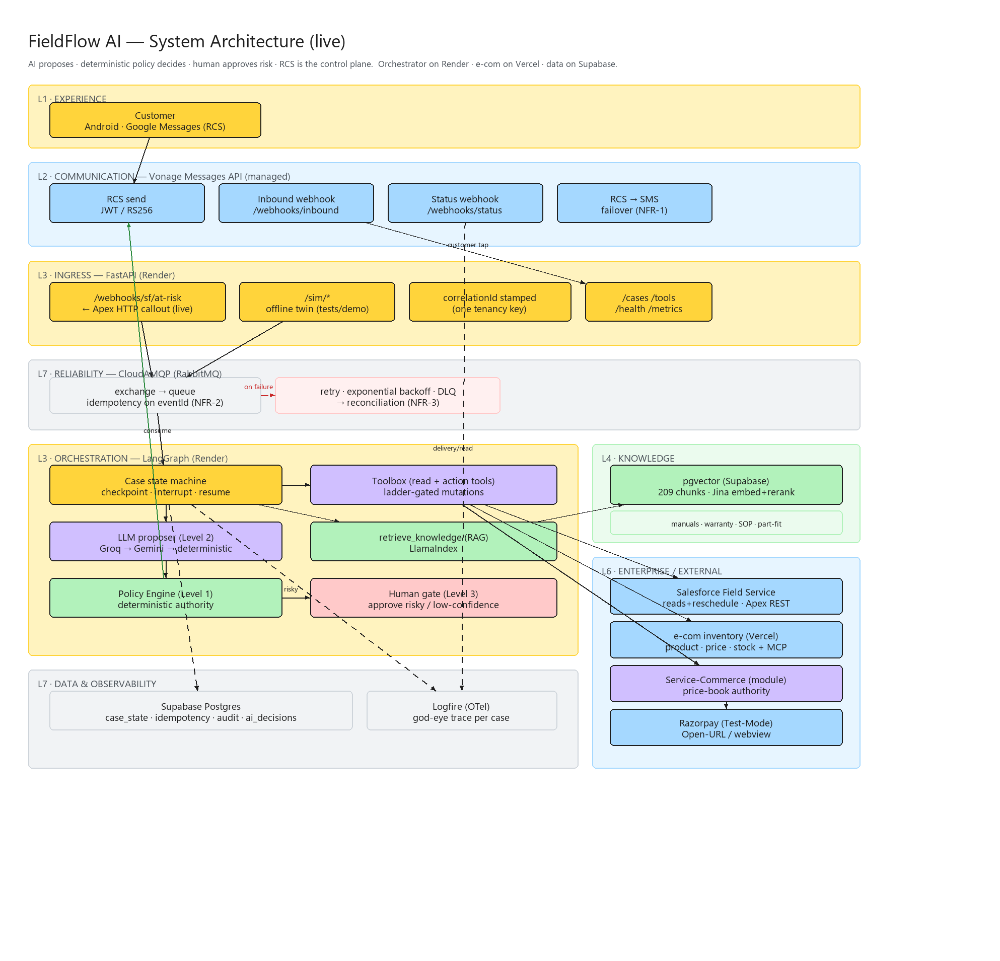
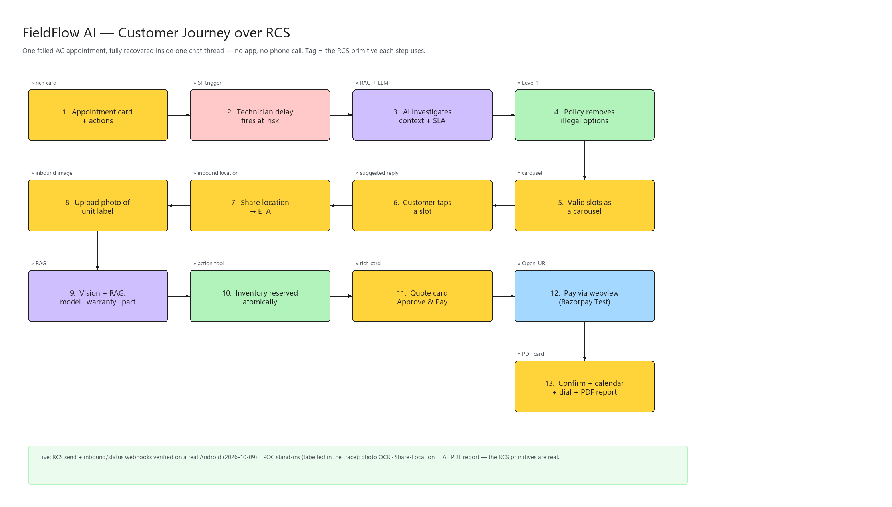
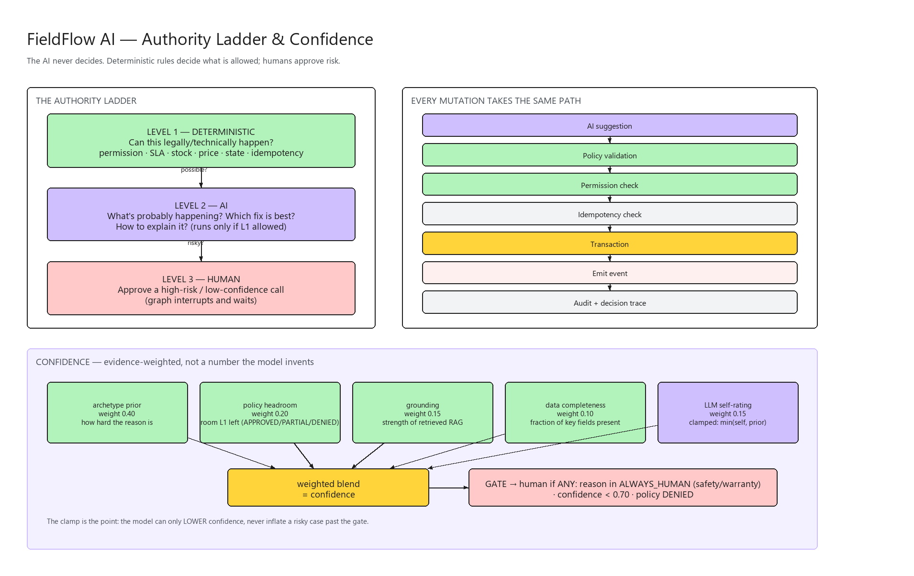
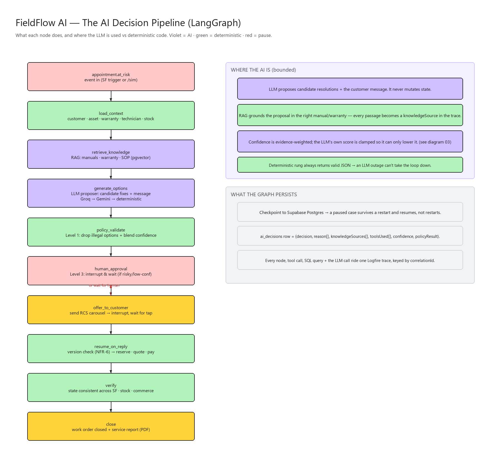
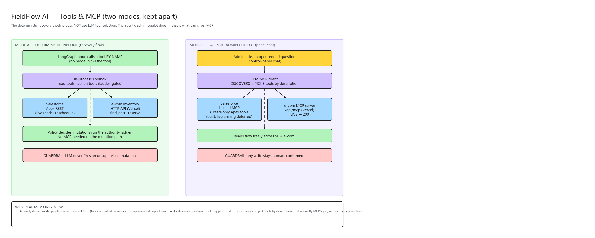
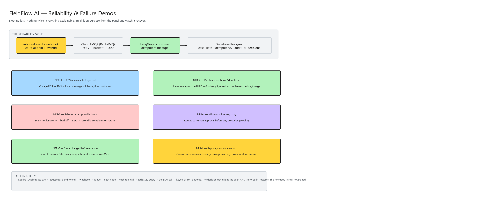
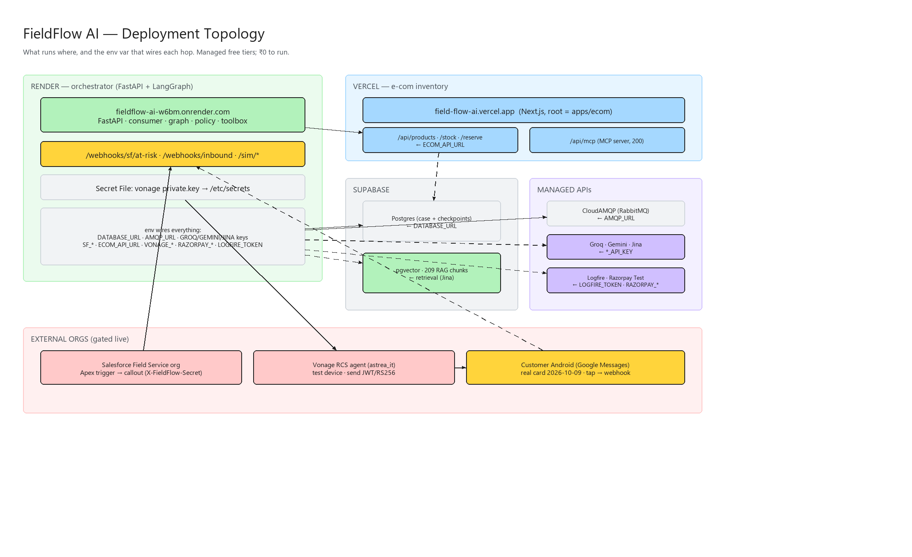
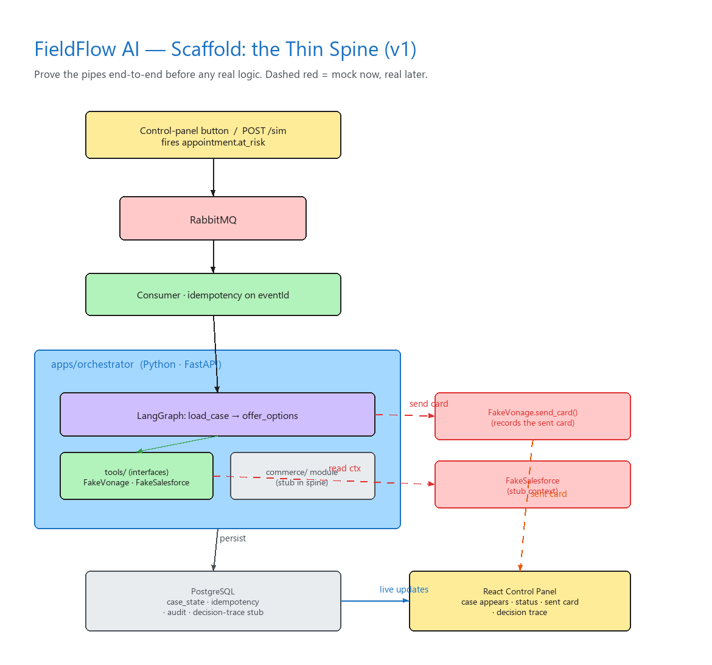

# FieldFlow AI — Diagrams

Rich diagrams of the system (built for a manager / new-reader review). They reflect the **live**
system as of 2026-10-13.

> **What's in git:** the rendered **PNGs** (below). The `.excalidraw` sources are **gitignored** —
> they're large JSON and are regenerated from [`gen_diagrams.py`](gen_diagrams.py), so we keep the
> repo diffs small and commit the images instead. To edit a diagram, edit the script and re-run it
> (see *How they're made* below).

## 01 · System architecture (live)
"A complete, deployed enterprise decision-and-execution system. RCS is the control plane."


## 02 · Customer journey over RCS
"One failed AC appointment, fully recovered through RCS — no app, no phone call."


## 03 · Authority ladder & confidence
"The AI never decides. Deterministic rules do; humans approve risk — and confidence can't be gamed."


## 05 · The AI decision pipeline
"This is the AI part — and exactly how it's bounded so it's safe to run operations."


## 06 · Tools & MCP (two modes)
"Real MCP earns its place in the open-ended copilot — not in the deterministic pipeline."


## 07 · Reliability & failure demos
"Break it on purpose from the panel and watch it recover. The telemetry is real."


## 08 · Deployment topology
"Deployed, always-on, ₹0 to run. Here's the physical wiring and the env var for each hop."


## 04 · Scaffold (historical)
The original thin-spine scaffold — "we proved the pipes end-to-end before any real logic."
Kept for history; see [`../scaffold.md`](../scaffold.md).


## How they're made / editing

Both the (gitignored) `.excalidraw` sources and the committed PNGs are produced by one deterministic
script:

```bash
python docs/specs/field-service-recovery/diagrams/gen_diagrams.py
```

It writes `01/02/03/05/06/07/08.excalidraw`, then renders **every** `.excalidraw` in the folder
(including the historical `04-scaffold`) to a `.png`. So: **edit the script → re-run → commit the
changed PNGs.** Hand-tweaks to a `.excalidraw` file are local only and are lost on a regenerate.

- Want to tweak by hand instead? Open the `.excalidraw` in Excalidraw (VS Code *Excalidraw*
  extension, or drag it onto <https://excalidraw.com>), export a PNG, and commit that. The committed
  PNG is the source of truth for the repo.
- The committed PNGs are an **approximate** render (straight arrows, no hand-drawn roughness). Open
  the `.excalidraw` for the polished Excalidraw look.

**Colour key:** yellow = customer-facing / core · green = deterministic / knowledge ·
violet = AI & tools · red = failure / event · blue = external systems · grey = infra / data.

> Per the project convention, the text versions of these flows also live in
> [`../context/`](../context/) and [`../srs.md`](../srs.md); these diagrams are the presentation
> layer. If a flow changes, update the text first, then regenerate the diagram.
